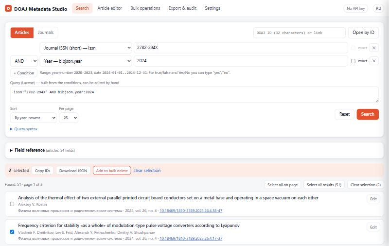
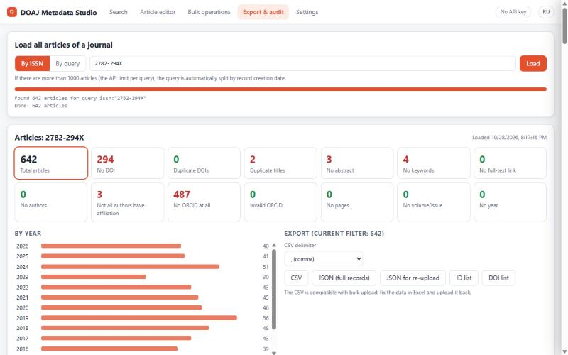

# DOAJ Metadata Studio

[Русская версия](README.md)

A browser-based tool for working with article and journal metadata in [DOAJ](https://doaj.org) (Directory of Open Access Journals) via the [DOAJ API v4](https://doaj.org/api/v4/docs).

Built for editors and publishers of open access journals: find articles, audit metadata completeness, fix records, bulk-upload new articles and export everything to a spreadsheet.

> **Unofficial tool.** This project is not affiliated with or endorsed by DOAJ. The DOAJ name is used only to indicate which service the app works with.



## Features

**Search**
- Articles and journals, a query builder covering every DOAJ field (54 article fields, 83 journal fields), AND / OR / NOT, exact match (`.exact`), ranges.
- Built-in field reference with descriptions, value types and tested examples — click to insert a condition.
- Record view with metadata warnings and raw JSON; open by DOAJ ID.
- Select on page or all results (up to 1000) → copy IDs, download JSON, bulk delete.

**Article editor** *(API key required)*
- Full form: authors with affiliations and ORCID, keywords, DOI, ISSN, volume/issue/pages, links.
- Live validation: ISSN and ORCID check digits, DOI format, mandatory full-text link, max 6 keywords.
- Create, update and delete; the outgoing JSON is visible and editable.

**Bulk operations** *(API key required)*
- Upload a batch from JSON or CSV/Excel with per-record validation.
- Track upload status by `upload_id`; bulk delete with confirmation.

**Export & audit**
- Fetch every article of a journal by ISSN or any query; the API's 1000-result cap is worked around by automatically splitting the query.
- Problem summary: missing DOI, duplicate DOIs and titles, missing abstract, keywords, ORCID, affiliations, pages, etc.
- Export to CSV (round-trips with bulk upload — fix in Excel and re-upload), JSON, ID and DOI lists.
- Reconcile against a list of DOIs from any source.



## Usage

**Online:** <https://doajmds.site/en/> (English) · <https://doajmds.site> (Russian)

**Locally:** download [`en/index.html`](en/index.html) and open it in a browser. No install, server or build step — it is a single dependency-free HTML file.

Search and export need no account. Creating, updating and deleting articles requires a publisher API key: DOAJ **Dashboard → Settings → Generate a new API key**, then paste it on the Settings tab.

## Security & data

- Runs entirely in the browser and talks only to `https://doaj.org/api/v4`. No other servers, analytics or third-party scripts.
- The API key is kept for the current tab only (`sessionStorage`) unless you tick “remember” (`localStorage`).
- Deletions are irreversible; single deletes ask for confirmation, bulk deletes require typing the record count.

## DOAJ API notes

- Only the first 1000 results of any query are reachable.
- Wildcards inside terms, fuzzy `~`, regex and open-ended ranges (`TO *`) are rejected.
- `doi:` and `issn:` are aliases, not fields: `_exists_:doi` is always false. Articles without DOI: `NOT _exists_:index.doi`.
- Quote DOIs containing slashes: `doi:"10.18469/1810-3189.2022.25.4.122-128"`.
- Pages are sent as `bibjson.journal.start_page` but searched as `bibjson.start_page`.
- `index.country` / `index.language` take English names (`"Russian Federation"`), `bibjson.*.country` takes codes (`RU`).
- Sort by year with `bibjson.year.exact:desc`.

## Development

The Russian [`index.html`](index.html) is the single source. The English page is generated from it:

```bash
python tools/build_en.py
```

The script translates every Russian UI fragment using [`tools/en.tsv`](tools/en.tsv) (Russian⇥English, one per line) and writes [`en/index.html`](en/index.html). If you change Russian text, rerun it — it lists any fragment that still needs a translation.

## License

[MIT](LICENSE)
