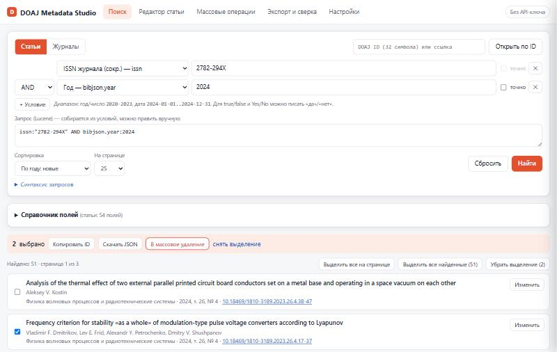
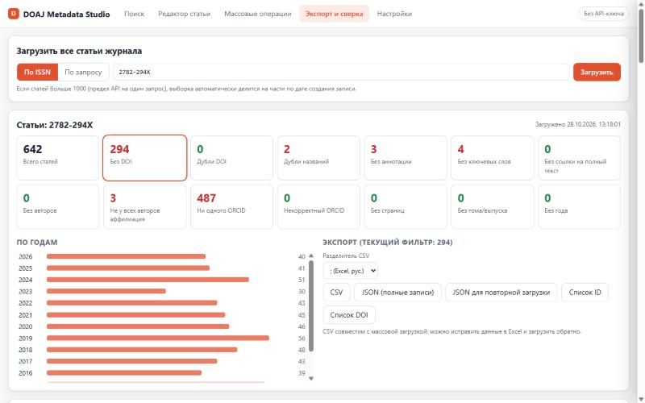

# DOAJ Metadata Studio

[English version](README.en.md)

Браузерный инструмент для работы с метаданными статей и журналов в [DOAJ](https://doaj.org) (Directory of Open Access Journals) через [DOAJ API v4](https://doaj.org/api/v4/docs).

Для редакторов и издателей открытых журналов: найти статьи, проверить полноту метаданных, исправить записи, загрузить новые статьи пакетом и выгрузить всё в Excel.

> **Неофициальный инструмент.** Проект не связан с DOAJ и не поддерживается его командой. Название DOAJ используется только для указания, с каким сервисом работает приложение.



## Возможности

**Поиск**
- Статьи и журналы, конструктор запросов по всем полям DOAJ (54 поля статей, 83 поля журналов), операторы AND / OR / NOT, точное совпадение (`.exact`), диапазоны.
- Встроенный справочник полей с описаниями, типами значений и проверенными примерами — щелчок вставляет условие в запрос.
- Карточка записи с замечаниями к метаданным и сырым JSON, открытие по DOAJ ID.
- Выделение на странице или всех найденных (до 1000) → копирование ID, JSON, массовое удаление.

**Редактор статьи** *(нужен API-ключ)*
- Форма со всеми полями: авторы с аффилиациями и ORCID, ключевые слова, DOI, ISSN, выходные данные, ссылки.
- Проверка при вводе: контрольные цифры ISSN и ORCID, формат DOI, обязательная ссылка на полный текст, не более 6 ключевых слов.
- Создание, изменение и удаление статьи; JSON для отправки виден и редактируется.

**Массовые операции** *(нужен API-ключ)*
- Загрузка пакета статей из JSON или CSV/Excel с предварительной проверкой каждой записи.
- Отслеживание статуса загрузки по `upload_id`, массовое удаление с подтверждением.

**Экспорт и сверка**
- Выгрузка всех статей журнала по ISSN или по произвольному запросу. Ограничение API в 1000 записей обходится автоматическим разбиением выборки.
- Сводка проблем: без DOI, дубли DOI и названий, без аннотации, ключевых слов, ORCID, аффилиаций, страниц и т. д.
- Экспорт в CSV (совместим с массовой загрузкой — можно исправить в Excel и загрузить обратно), JSON, списки ID и DOI.
- Сверка со списком DOI из любого источника: что есть в DOAJ, чего нет, что лишнее.



## Как пользоваться

**Онлайн:** <https://doajmds.site>

**Локально:** скачайте [`index.html`](index.html) и откройте двойным щелчком. Установка, сервер и сборка не нужны — это один HTML-файл без зависимостей.

Поиск и экспорт работают без регистрации. Для создания, изменения и удаления статей нужен API-ключ издателя: личный кабинет DOAJ → **Dashboard → Settings → Generate a new API key**. Ключ вводится во вкладке «Настройки».

## Безопасность и данные

- Приложение работает целиком в браузере и обращается только к `https://doaj.org/api/v4`. Других серверов, аналитики и сторонних скриптов нет.
- API-ключ по умолчанию хранится только до закрытия вкладки (`sessionStorage`). Сохранить его в браузере (`localStorage`) можно галочкой в настройках.
- Удаление статей необратимо: одиночное удаление требует подтверждения, массовое — ввода числа удаляемых записей.
- Рекомендуется сначала проверить создание и изменение на одной тестовой статье.

## Особенности DOAJ API

Выяснено при разработке, учтено в приложении и справочнике полей:

- По одному запросу доступны только первые 1000 результатов.
- Шаблоны `*` и `?` внутри слов, нечёткий поиск `~`, регулярные выражения и открытые диапазоны (`TO *`) запрещены.
- `doi:` и `issn:` — сокращения, а не поля: `_exists_:doi` всегда ложно. Статьи без DOI: `NOT _exists_:index.doi`.
- DOI со слешем нужно брать в кавычки: `doi:"10.18469/1810-3189.2022.25.4.122-128"`.
- Страницы при загрузке задаются в `bibjson.journal.start_page`, а искать их нужно по `bibjson.start_page`.
- `index.country` и `index.language` — английские названия (`"Russian Federation"`), `bibjson.*.country` — коды (`RU`).
- Сортировка по году: `bibjson.year.exact:desc`.

## Разработка

Весь код — в [`index.html`](index.html): HTML, CSS и JavaScript без фреймворков и сборки. Для локальной проверки достаточно открыть файл в браузере или запустить любой статический сервер:

```bash
python -m http.server 8000
```

Предложения и сообщения об ошибках — в [Issues](https://github.com/tsentavta/doajmds/issues).

## Лицензия

[MIT](LICENSE)
